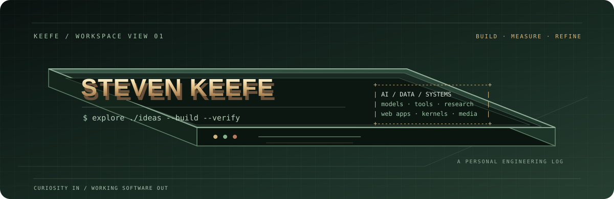

<!--
  Profile README — terminal / systems / strategy visual language.
  Keep every project description aligned with its repository's current state.
-->

<p align="center">
  
</p>

<h1 align="center">Steven Keefe</h1>

<p align="center">
  <strong>AI engineering · software systems · open-source experiments</strong>
</p>

<p align="center">
  <a href="https://keefe.is-a.dev">Portfolio</a>
  &nbsp;◆&nbsp;
  <a href="https://github.com/CallmeKeefe?tab=repositories">GitHub projects</a>
  &nbsp;◆&nbsp;
  <a href="https://huggingface.co/KeefeBuild">Hugging Face</a>
</p>

<p align="center">
  <sub>Build with curiosity. Test with discipline. Explain the limits.</sub>
</p>

---

## `$ whoami`

I’m an independent developer and builder exploring the intersection of **artificial intelligence, software engineering, and computer systems**.

I’m interested in how intelligent software works beneath the interface: how models are trained and evaluated, how tools and agents interact with real systems, how applications stay dependable, and how low-level software moves from a boot sequence toward a usable platform.

My projects are a mix of practical applications and research-driven experiments:

- **AI and model work** — fine-tuning experiments, model evaluation, tool grounding, and consistency under changing evidence.
- **Developer tools** — diagnostics, mathematical utilities, automation workflows, and interfaces that make complex tasks easier to inspect.
- **Systems engineering** — Rust, boot processes, kernel foundations, and the boundary between applications and hardware.
- **Creative computing** — audio workflows, interactive 3D visuals, video production systems, and strategy-game interfaces.

I learn by building, measuring, debugging, and documenting what did *not* work. I care more about a clear engineering explanation than an impressive-sounding feature list.

<p align="center">
  
</p>

### A small terminal snapshot

```text
      _  __          __       ____  __
     / |/ /__  ___  / /__    / __ \/ /__  ___
    /    / _ \/ _ \/  '_/   / /_/ / / _ \/ _ \
   /_/|_/\___/\___/_/\_\    \____/_/\___/\___/

   $ focus
   +-- artificial intelligence
   +-- software & systems engineering
   +-- open-source tools
   +-- research through experiments

   $ workflow
   observe -> prototype -> test -> refine -> document
```

---

## `$ ./work --featured`

The projects below represent the main themes of my work. Each description reflects the repository's documented scope; experimental projects are labelled as such.

<p align="center">
  
</p>

### 01 / Research & model evaluation

**[Data-Provecta](https://huggingface.co/datasets/KeefeBuild/Data-Provecta)**  
*A benchmark dataset for reasoning that must stay grounded as the world changes.*

Explores long-horizon state tracking, temporal consistency, conflicting evidence, tool grounding, uncertainty calibration, and adversarial robustness. Scenarios are structured around an authoritative state, an evolving evidence trail, expected tool interactions, and explicit failure conditions.

- Focus: state tracking, evidence quality, tool use, consistency, and adversarial scenarios.
- Format: structured JSON dataset for evaluation and training-support experiments.
- [Dataset card](https://huggingface.co/datasets/KeefeBuild/Data-Provecta)

**[Keefe-Discere](https://huggingface.co/KeefeBuild/Keefe-Discere)**  
*An open model-development and fine-tuning project.*

A Qwen2.5-family language-model project exploring instruction tuning, coding and mathematics-oriented behavior, model merging, and distributable model formats. The Hugging Face repository includes model artifacts and usage paths for common inference tooling.

- Focus: model adaptation, training workflows, and practical model distribution.
- License shown on the model repository: Apache-2.0.
- [Model repository](https://huggingface.co/KeefeBuild/Keefe-Discere)

### 02 / AI reliability & developer tools

**[LLM Hallucination Checker Edge](https://github.com/CallmeKeefe/llm-hallucination-checker-edge)**  
*Inspect structural warning signs in LLM traces.*

An OpenTelemetry-oriented diagnostic utility that parses GenAI trace spans and flags signals such as empty completions, missing citation markers, and missing model metadata. The Python core, edge Worker, and browser widget use deterministic heuristics.

- Python library and CLI, Cloudflare Worker, and browser-based trace widget.
- No external LLM judge is required for its heuristic checks.
- **Important boundary:** it does not determine whether a response is factually true. Its score is a structural triage signal, not a calibrated hallucination probability.
- [Live demo](https://llm-hallucination-checker.pages.dev/) · [Source](https://github.com/CallmeKeefe/llm-hallucination-checker-edge)

### 03 / Audio & language workflows

**[VoxShift](https://github.com/CallmeKeefe/Vox-Shift)**  
*An evolving workspace for speech, transcripts, and language workflows.*

A web application combining upload and real-time audio interfaces, transcription and transcript workflows, provider routing, persistence, and a separate FastAPI-based audio service.

- Stack documented in the repository: Next.js, React, TypeScript, Prisma, and Python/FastAPI components.
- Provider availability, language coverage, and model quality depend on the configured services.
- [Open app](https://vox-shift.vercel.app/) · [Source](https://github.com/CallmeKeefe/Vox-Shift)

### 04 / Mathematics & learning tools

**[Keefe Calculator](https://github.com/CallmeKeefe/Keefe-Calculator)**  
*A browser-based workspace for mathematical exploration.*

Combines a scientific calculator, function graphing, unit conversion, scientific constants, calculation history, and optional cloud or AI-assisted features.

- React and Vite application with KaTeX-based mathematical typesetting.
- Includes a Progressive Web App experience and solver regression tests.
- **Important boundary:** it is not a full computer-algebra system; optional integrations depend on their configuration.
- [Open calculator](https://keefe-calculator.vercel.app/) · [Source](https://github.com/CallmeKeefe/Keefe-Calculator)

---

## `$ ls ./other-work`

| Project | What it explores | Current scope |
|:--|:--|:--|
| [Personal Website](https://github.com/CallmeKeefe/Personal-Website) · [Live](https://keefe.is-a.dev) | Multilingual portfolio, interactive WebGL/3D visuals, audio experiments, and optional AI-assisted visitor interactions. | Portfolio application; integrations depend on deployment configuration. |
| [Keefe AI](https://github.com/CallmeKeefe/Keefe-AI) · [Live](https://keefe-ai.vercel.app/) | Experimental browser-based AI workspace for multi-provider chat, project workflows, and optional integrations. | Active experiment; feature availability varies by implementation and configured services. |
| [Universal Video Studio](https://github.com/CallmeKeefe/universal-video-studio) | Remotion video compositions plus a local production platform for jobs, scheduling, research, memory, skills, and render benchmarking. | Developer production toolkit; social publishing depends on provider approval and credentials. |
| [KeefeOS](https://github.com/CallmeKeefe/Keefe-OS) | Rust-based x86-64 operating-system foundations, UEFI boot flow, kernel development, and QEMU/OVMF testing. | Experimental VM prototype; not a physical-device installer or general-purpose OS. |
| [Xiangqi Game](https://github.com/CallmeKeefe/xiangqi-game) | Browser-based Chinese chess with local play, an AI opponent, difficulty settings, move history, and in-page analysis. | Local two-player or human-vs-AI game; no online multiplayer. |
| [B2B Vertical Micro-SaaS](https://github.com/CallmeKeefe/B2B-Vertical-Micro-SaaS) | A dashboard foundation for exploring a vertical SaaS product. | UI scaffold with sample data; authentication, billing, tenant isolation, and production workflows are not implemented. |

---

## `$ cat principles.txt`

- **Evidence over appearance** — distinguish a tested capability from a roadmap idea.
- **Useful over complicated** — build the smallest system that solves a real problem.
- **Open by default** — document projects so other developers can inspect, learn, and contribute.
- **Failure is information** — use tests, logs, and review to find what needs to change.
- **Respect the boundary** — explain privacy, reliability, and security limitations instead of hiding them.

## `$ stack --across-projects`

<details>
<summary><strong>Languages, frameworks, and tools</strong></summary>

| Area | Technologies appearing across my repositories |
|:--|:--|
| Languages | Python · Rust · C++ · TypeScript · JavaScript |
| AI & ML | PyTorch · Hugging Face · Transformers · Unsloth |
| Web | React · Next.js · Vite · Node.js · Tailwind CSS |
| Data & services | Prisma · Firebase · Supabase · FastAPI |
| Systems & media | UEFI · QEMU · Remotion · WebGL |
| Engineering workflow | GitHub Actions · Docker · Vercel · Cloudflare |

<sub>This is a cross-project technology index, not a claim of equal depth or expertise in every tool.</sub>

</details>

## `$ find ./next-questions`

I’m especially interested in:

- Reliable AI systems and evaluation beyond one-shot accuracy.
- Models that can track state, use tools faithfully, and communicate uncertainty.
- Operating-system design, kernel architecture, and safe systems interfaces.
- Open-source developer tools and accessible learning software.
- Interactive computing, audio, graphics, and thoughtful product design.

---

<p align="center">
  <strong>Measure twice. Build once. Keep learning.</strong>
  <br />
  <a href="https://keefe.is-a.dev">Portfolio</a>
  &nbsp;◆&nbsp;
  <a href="https://github.com/CallmeKeefe">GitHub</a>
  &nbsp;◆&nbsp;
  <a href="https://huggingface.co/KeefeBuild">Hugging Face</a>
</p>
