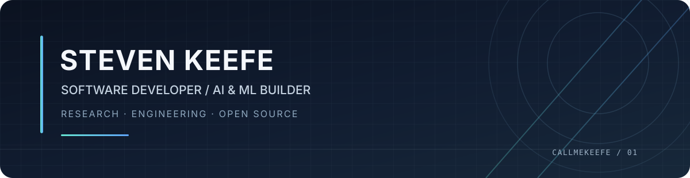

  <a href="https://keefe.is-a.dev/">Portfolio</a>
  &nbsp;·&nbsp;
  <a href="https://huggingface.co/KeefeBuild">Hugging Face</a>
  &nbsp;·&nbsp;
  <a href="https://github.com/CallmeKeefe?tab=repositories">GitHub repositories</a>

**AI/ML · Software Engineering · Open Source**

---

## About

I'm an independent developer building at the intersection of **AI/ML, web engineering, and developer tools**. I enjoy turning complex ideas into practical software—from fine-tuning and evaluating language models to shipping browser-based applications.

My approach is research-led and iterative: understand the problem, build a useful version, test its limits, document what the evidence supports, and keep improving.

I care about **clear engineering, honest claims, reproducible work, and useful outcomes** more than hype.

## Selected work

A selection of released projects and public work. Each description links directly to its source or model page.

### 01 · [Data-Provecta](https://huggingface.co/datasets/KeefeBuild/Data-Provecta)

**AI evaluation dataset · Hugging Face**

A structured dataset for examining whether AI systems can remain consistent as a scenario evolves. It focuses on long-horizon reasoning, state tracking, conflicting evidence, tool grounding, adversarial variations, and uncertainty calibration.

[Dataset and documentation ↗](https://huggingface.co/datasets/KeefeBuild/Data-Provecta)

### 02 · [Keefe-Discere](https://huggingface.co/KeefeBuild/Keefe-Discere)

**Fine-tuned language model · Qwen2.5 · Apache-2.0**

A published Qwen2.5-based fine-tuning project with model artifacts in Safetensors and GGUF formats, plus usage instructions for common inference workflows.

[Model repository ↗](https://huggingface.co/KeefeBuild/Keefe-Discere)

### 03 · [LLM Hallucination Checker Edge](https://github.com/CallmeKeefe/llm-hallucination-checker-edge)

**Open-source developer tool · Python · OpenTelemetry**

A lightweight diagnostic utility for GenAI trace spans. Deterministic heuristics flag structural signals such as empty completions, missing citation markers, and missing model metadata. Its score is a **triage signal, not a probability of hallucination or a verification of factual truth**.

[Source code ↗](https://github.com/CallmeKeefe/llm-hallucination-checker-edge) · [Live demo ↗](https://llm-hallucination-checker.pages.dev/)

### 04 · [Xiangqi Game](https://github.com/CallmeKeefe/xiangqi-game)

**Browser-based strategy game · HTML · JavaScript**

A self-contained Chinese chess game with local two-player play and a built-in AI opponent. Includes difficulty settings, move history, undo, and in-page analysis. It is a local browser game rather than an online multiplayer service.

[Play and inspect the code ↗](https://github.com/CallmeKeefe/xiangqi-game)

## Deployed products

| Product | What it offers | Link |
|---|---|---|
| **Vox-Shift** | Full-stack web application | [Open ↗](https://vox-shift.vercel.app/) |
| **Keefe Calculator** | Browser-based calculator | [Open ↗](https://keefe-calculator.vercel.app/) |
| **Personal website** | Portfolio and project hub | [Visit ↗](https://keefe.is-a.dev/) |

## Technical toolkit

| Focus | Technologies |
|---|---|
| **Languages** | Python · Rust · C++ · JavaScript · TypeScript |
| **Web engineering** | React · Next.js · Node.js · Tailwind CSS · Prisma |
| **AI / machine learning** | PyTorch · Hugging Face · Transformers · Unsloth · LoRA |
| **Backend & platforms** | Firebase · Supabase · Vercel |
| **Developer workflow** | Git · GitHub Actions · Docker |

This is a snapshot of technologies I've used across projects, not a claim of equal depth in every tool.

## Beyond code

I enjoy disciplines that reward pattern recognition, patience, and deliberate practice.

- **Writing —** author of *DEAD RECKONING*, a self-published hard science-fiction psychological thriller.
- **Strategy —** Xiangqi tournament award recipient; also study Western chess and Go, with an interest in tactics, positional play, and endgames.
- **Music —** piano arrangements and traditional melodies using MuseScore and BandLab; Erhu practice.
- **Hands-on building —** built a small motorized seed-spreader prototype using repurposed materials and basic electronics.

## What I'm exploring

- Reliable AI evaluation, grounded reasoning, and long-horizon state tracking.
- Language-model fine-tuning, tool use, and uncertainty calibration.
- Systems programming, operating-system architecture, and performance.
- Responsive web applications and developer tools that are useful, testable, and maintainable.

## Collaboration

I'm interested in thoughtful collaboration on **AI evaluation, developer tooling, and practical open-source software**.

The best starting point is a public repository: explore the implementation, open an issue with a reproducible example, or share specific technical feedback.

---

**Build carefully. Validate with evidence. Improve continuously.**

Thanks for visiting.

