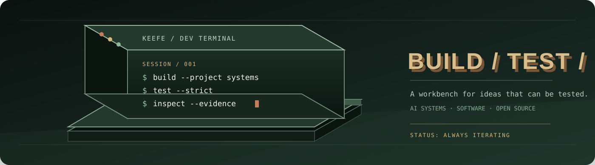
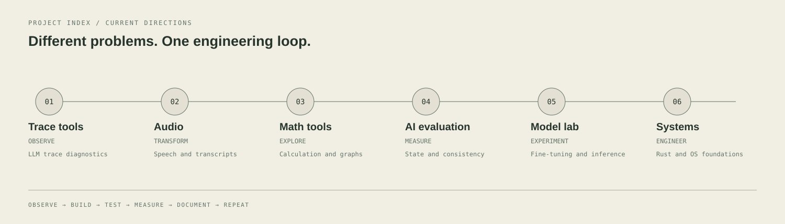

<!--
  Profile README — project atlas and deep-jade terminal identity.
  Keep every status and capability aligned with the linked source of truth.
-->

<p align="center">
  
</p>

<h1 align="center">Steven Keefe</h1>
<p align="center"><strong>AI systems · model research · software engineering · systems experiments</strong></p>
<p align="center">
  <a href="https://keefe.is-a.dev">Portfolio</a> ·
  <a href="https://github.com/CallmeKeefe?tab=repositories">GitHub</a> ·
  <a href="https://huggingface.co/KeefeBuild">Hugging Face</a>
</p>
<p align="center"><sub>Build carefully. Test honestly. Improve from evidence.</sub></p>

---

## `$ whoami`

I'm an independent developer exploring how intelligent software is built, evaluated, and made useful. My work moves between model experiments, AI evaluation, web products, audio tools, developer utilities, and low-level systems.

I prefer projects that can be inspected rather than described with inflated claims: a model card, a reproducible test, a working demo, a clear limitation, or a trace that explains what happened.

**Questions behind the work**
- Can an AI system keep track of changing facts and conflicting evidence?
- How can model behavior be tested beyond a single accuracy score?
- How can useful tools make complicated workflows feel simpler?
- What does it take to build an operating system from the boot path upward?
- Can a visual interface be expressive without sacrificing clarity or accessibility?

<p align="center">
  
</p>

### Workbench / terminal session

```text
keefe@workstation:~/projects$ git status --short
 M README.md
?? tests/edge-cases.md

keefe@workstation:~/projects$ pytest -q
..............................
30 passed

keefe@workstation:~/projects$ git diff --check
# inspect the diff before committing
```

---

## `$ tree ./work`

A map of the main areas I build in:

<p align="center">
  
</p>

## Public projects

### 01 · LLM Hallucination Checker Edge
**Structural diagnostics for LLM traces.**

An OpenTelemetry-oriented utility that parses GenAI trace spans and flags signals such as empty completions, missing citation markers, and missing model metadata. It includes a Python core, dependency-free edge Worker, browser interface, and CLI.

- Deterministic heuristics; no external LLM judge required.
- Useful for trace triage and instrumentation checks.
- **Boundary:** it does not verify factual correctness or reliably detect hallucinations. Its score is not a probability of truth or error.

[Source repository](https://github.com/CallmeKeefe/llm-hallucination-checker-edge) · [Live demo](https://llm-hallucination-checker.pages.dev/)

### 02 · KeefeOS
**An experimental x86-64 operating-system prototype.**

A Rust-based systems project exploring the UEFI boot path, kernel boundaries, memory handling, and QEMU/OVMF validation.

- Current verified scope is the documented QEMU + OVMF environment.
- The repository records boot checks across 256 MiB, 512 MiB, and 1 GiB virtual-memory profiles.
- **Boundary:** this is not a general-purpose installable OS; physical hardware support, a complete driver stack, and production security are not claimed.

[Source repository](https://github.com/CallmeKeefe/Keefe-OS) · [Build and boot guide](https://github.com/CallmeKeefe/Keefe-OS/blob/main/docs/BUILD_AND_BOOT_GUIDE.md) · [CI](https://github.com/CallmeKeefe/Keefe-OS/actions)

### 03 · Xiangqi — Chinese Chess
**A self-contained browser game.**

A single-page Xiangqi implementation with local two-player play, an AI opponent, selectable difficulty, move history, undo, sound controls, and an in-page analysis panel.

- No build tool or package installation is required.
- **Boundary:** no online multiplayer; difficulty labels are application settings, not a claim of tournament-engine strength.

[Source repository](https://github.com/CallmeKeefe/xiangqi-game)

---

## Private-source projects and active work

Some projects have public demos or documentation while their source repositories remain private. They are listed here because they are part of the work, not presented as open-source repositories.

| Project | What it explores | Public entry point / source status |
|:--|:--|:--|
| **Personal Website** | Multilingual portfolio, responsive project pages, WebGL/3D experiments, audio and optional AI visitor interactions | [Live portfolio](https://keefe.is-a.dev) · [private source](https://github.com/CallmeKeefe/Personal-Website) |
| **VoxShift** | Transcription, translation, transcript management, audio tools, and the separate Keefe Omni Audire provider service | [Live app](https://vox-shift.vercel.app/) · [private source](https://github.com/CallmeKeefe/Vox-Shift) |
| **Keefe Calculator** | Scientific calculation, graphing, unit conversion, reference tools, history, PWA support, and optional cloud/AI features | [Live app](https://keefe-calculator.vercel.app/) · [private source](https://github.com/CallmeKeefe/Keefe-Calculator) |
| **Keefe AI** | Experimental multi-provider AI workspace with project-oriented workflows and optional integrations | [Repository](https://github.com/CallmeKeefe/Keefe-AI) · private |
| **Universal Video Studio** | Remotion-based video authoring and a local production workflow for jobs, scheduling, research, rendering, and quality checks | [Repository](https://github.com/CallmeKeefe/universal-video-studio) · private |
| **Security & Privacy Tools** | Experimental Python tools for privacy education, digital provenance, and authorized defensive assessment | [Repository](https://github.com/CallmeKeefe/Security) · private; not production-approved |
| **B2B Vertical Micro-SaaS** | Early dashboard scaffold for exploring a focused B2B software product | [Repository](https://github.com/CallmeKeefe/B2B-Vertical-Micro-SaaS) · private; UI scaffold only |

**Other early product explorations:** AIKU / Keefe.dict (language and dictionary tooling) and a multi-game board platform for chess, Xiangqi, and Go. These are not presented as released products or public repositories.

---

## `$ huggingface catalog`

My Hugging Face work includes language-model fine-tuning experiments, speech-model experiments, and a reasoning-evaluation dataset.

### Keefe-Discere — language-model series

An experimental Qwen2/Qwen2.5-based model-development series. Published checkpoints and quantized artifacts are separate Hub repositories; version labels do not imply a standardized benchmark ranking.

| Published artifact | Format / notes |
|:--|:--|
| [Keefe-Discere](https://huggingface.co/KeefeBuild/Keefe-Discere) | Main repository; Transformers, Safetensors, and GGUF artifacts |
| [Keefe-Discere v3.2](https://huggingface.co/KeefeBuild/Keefe-Discere-v3.2) | Earlier fine-tuned checkpoint |
| [Keefe-Discere v4.0 Final](https://huggingface.co/KeefeBuild/Keefe-Discere-v4.0-Final) | 8B Safetensors checkpoint |
| [Keefe-Discere v5.0 GGUF](https://huggingface.co/KeefeBuild/Keefe-Discere-v5.0-GGUF) | GGUF / llama.cpp distribution |
| [Keefe-Discere v5.0 GodTier Q4_K_M GGUF](https://huggingface.co/KeefeBuild/Keefe-Discere-v5.0-GodTier-Q4_K_M-GGUF) | Quantized 4-bit GGUF artifact |

**Additional version-lineage names found during the catalog search:** `Keefe-Discere-v3.0-Ultimate`, `Keefe-Discere-v3.0-Final`, `Keefe-Discere-v3.1`, `Keefe-Discere-v3.3`, `Keefe-Discere-v5.0`, and `Keefe-Discere-v5.0-GodTier`. Some appear as base-model or provider-catalog references rather than independently confirmed public Hub cards, so I have not presented them as separately verified downloads. The [KeefeBuild model profile](https://huggingface.co/KeefeBuild?tab=models) is the live source of truth for current visibility and availability.

### Speech-model experiments

- [keefe-whisper-small-v5](https://huggingface.co/KeefeBuild/keefe-whisper-small-v5) — published Whisper-family speech-recognition checkpoint.
- **keefe-whisper-small-v6** — referenced by the VoxShift project documentation as its primary speech-recognition model; a public Hugging Face model card was not independently confirmed in this profile audit.

### Dataset and Space

- [Data-Provecta](https://huggingface.co/datasets/KeefeBuild/Data-Provecta) — a structured dataset and evaluation project for long-horizon grounded reasoning, temporal consistency, state tracking, tool grounding, conflict resolution, and uncertainty calibration. The current public viewer reports 80 rows across its published splits. Its evaluation framework includes a Multi-Trial Consistency (MTC) metric and adversarial scenario variants.
- [Keefe-Discere Multimodal OS Space](https://huggingface.co/spaces/KeefeBuild/Keefe-Discere-Multimodal-OS) — associated Space for the Keefe-Discere multimodal/OS experiment.

**Hub index:** [All KeefeBuild models](https://huggingface.co/KeefeBuild?tab=models) · [All datasets](https://huggingface.co/KeefeBuild?tab=datasets) · [All Spaces](https://huggingface.co/KeefeBuild?tab=spaces)

---

## `$ interests`

| Area | Current questions |
|:--|:--|
| **AI evaluation** | State tracking, temporal consistency, grounded tool use, uncertainty, adversarial testing |
| **Model development** | Fine-tuning, inference formats, quantization, reproducible experiments |
| **Speech and audio** | Recognition, transcription quality, translation, audio workflows |
| **Developer tools** | Diagnostics, automation, practical interfaces, testable workflows |
| **Systems engineering** | Rust, UEFI, x86-64, memory management, kernel boundaries, virtual-machine testing |
| **Product engineering** | Responsive web apps, accessibility, performance, deployment |
| **Strategy games** | Xiangqi, chess, Go, and game-interface design |

## `$ stack --from-projects`

<details>
<summary><strong>Languages, frameworks, and tools used across the work</strong></summary>

| Layer | Technologies |
|:--|:--|
| Languages | Python · Rust · C++ · TypeScript · JavaScript |
| AI and data | PyTorch · Hugging Face · Transformers · Unsloth · Pydantic |
| Web | React · Next.js · Vite · Node.js · Tailwind CSS |
| Systems | UEFI · x86-64 · QEMU · OVMF |
| Infrastructure | GitHub Actions · Vercel · Cloudflare Workers · Firebase · Supabase · Docker |
| Quality | pytest · Node test runner · Clippy · RustSec · CI workflows |

<sub>This is a map of technologies used across different projects, not a claim of equal expertise in every tool.</sub>
</details>

---

## `$ principles`

- **Evidence over hype.** A passing test proves only what that test covers.
- **Visible limitations.** A prototype should be described as a prototype.
- **Useful by design.** Clarity, accessibility, responsiveness, and performance matter.
- **Open where possible.** Publish work that others can inspect, use, and improve.
- **Iterate deliberately.** Treat failures as information about the next experiment.

<p align="center">
  
</p>

<p align="center">
  <strong>Make it useful. Make it testable. Make it better.</strong><br />
  <a href="https://keefe.is-a.dev">Portfolio</a> ·
  <a href="https://github.com/CallmeKeefe">GitHub</a> ·
  <a href="https://huggingface.co/KeefeBuild">Hugging Face</a>
</p>
